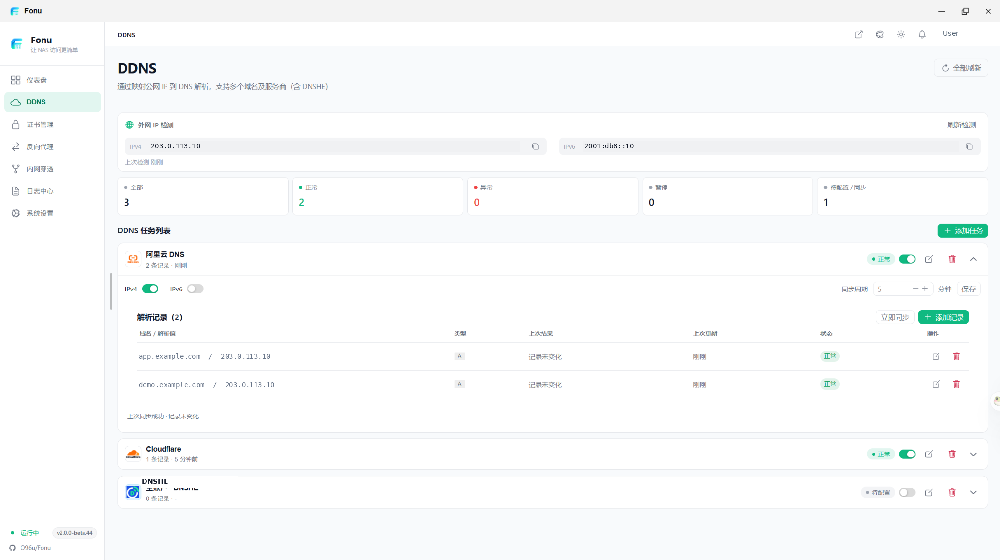
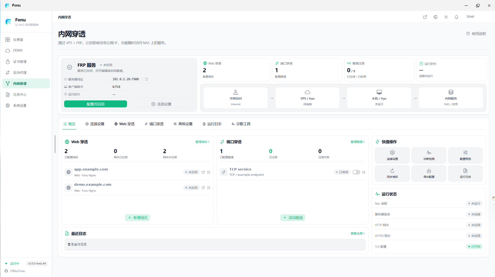

<p align="center">
  
</p>

<h1 align="center">Fonu</h1>

<p align="center"><strong>让 NAS 访问更简单</strong></p>

<p align="center">
  面向 <strong>飞牛 fnOS</strong> 的轻量公网访问管理工具<br />
  反向代理 · DDNS · HTTPS 证书 · 内网穿透 · 一站式 Web 管理
</p>

<p align="center">
  <a href="https://github.com/O96u/Fonu/releases"></a>
  <a href="https://github.com/O96u/Fonu/releases/latest"></a>
  <a href="https://github.com/O96u/Fonu/actions/workflows/ci.yml"></a>
  <a href="https://hub.docker.com/r/muxui/fonu"></a>
  
  
  
  
  
  <a href="https://www.gnu.org/licenses/gpl-3.0.html"></a>
</p>

---

## 简介

**Fonu** 是面向飞牛 fnOS 的轻量公网访问管理工具，集成 Nginx 反向代理、DDNS、ACME HTTPS 证书、FRP 内网穿透、日志与访问统计，无需手写配置即可统一管理 NAS 服务。

> **V2 候选版：v2.0.0-rc.01**。V2 为主要开发线；[v1 分支](https://github.com/O96u/Fonu/tree/v1) 保留旧版源码，[稳定版](https://github.com/O96u/Fonu/releases/latest) 仍面向生产环境。RC 尚未完成所有真机长期运行验收，升级前请备份。

## 功能特性

| 模块 | V2 功能 |
| --- | --- |
| 仪表盘 | 概览、访问分析、安全分析；公网 IPv4/IPv6、访问趋势、来源及服务排行；Fonu/Nginx/FRP 版本、CPU、内存与 Nginx 诊断 |
| DDNS | 多域名、多记录、独立 IPv4/IPv6 开关；Cloudflare、阿里云、DNSPod、腾讯云、火山引擎、华为云与 DNSHE |
| HTTPS 证书 | ACME 申请、导入、续签策略、DNS 凭证关联、本地部署与 SSH/SFTP 部署、部署历史 |
| 反向代理 | 独立规则、多域名、多端口、业务分组、列表/卡片、发现服务、访问控制、发布回滚、访问 IP 和实时/累计流量 |
| 内网穿透 | 内置 frpc；Web 网关及 TCP/UDP 隧道、连接设置、诊断与运行日志 |
| 日志中心 | 系统、访问、Nginx 与 FRP 日志；筛选、分页、导出及自动刷新 |
| 系统设置 | 主题、账户、反代安全、ACME、通知、日志统计、备份恢复和高级配置 |
| 消息通知 | 邮件、Webhook、Telegram、企业微信、飞书；DDNS、证书、安全事件及 Nginx 重载失败，发送记录可查 |
| 安全与性能 | 自动随机密钥迁移、凭证加密、备份校验、SQL 聚合与按需查询、资源回收、依赖漏洞扫描 |

## 界面展示

<details>
<summary>查看 V2 八张界面预览（仅脱敏示例）</summary>

截图中的域名、IP 和账号已用示例替换；截图来自 RC 前的 Beta 44 实机界面。预览文件目录为 `docs/screenshots/v2/`。

<table>
  <tr>
    <td width="50%" align="center"><b>仪表盘</b><br><a href="docs/screenshots/v2/dashboard.png"></a></td>
    <td width="50%" align="center"><b>DDNS</b><br><a href="docs/screenshots/v2/ddns.png"></a></td>
  </tr>
  <tr>
    <td width="50%" align="center"><b>证书管理</b><br><a href="docs/screenshots/v2/certificates.png"></a></td>
    <td width="50%" align="center"><b>反向代理</b><br><a href="docs/screenshots/v2/proxy.png"></a></td>
  </tr>
  <tr>
    <td width="50%" align="center"><b>内网穿透</b><br><a href="docs/screenshots/v2/frp.png"></a></td>
    <td width="50%" align="center"><b>日志中心</b><br><a href="docs/screenshots/v2/logs.png"></a></td>
  </tr>
  <tr>
    <td width="50%" align="center"><b>系统设置</b><br><a href="docs/screenshots/v2/settings.png"></a></td>
    <td width="50%" align="center"><b>主题外观</b><br><a href="docs/screenshots/v2/appearance.png"></a></td>
  </tr>
</table>

</details>

## 技术栈

| 层级         | 技术                                                                   |
| ------------ | ---------------------------------------------------------------------- |
| **后端**     | Go 1.27、标准库 HTTP、SQLite（modernc.org/sqlite）                     |
| **反向代理** | 内置 Nginx（动态生成配置、热重载）                                     |
| **证书**     | go-acme/lego（Let's Encrypt）                                          |
| **DDNS**     | Cloudflare / DNSPod / 阿里云 / 腾讯云 / 火山引擎 / 华为云 DNS API               |
| **内网穿透** | 内置 frpc（v0.71.x）；Web 网关穿透 Fonu Nginx，另支持 TCP/UDP 远程端口映射 |
| **前端**     | Vue 3、TypeScript、Vite、Naive UI、ECharts                             |
| **部署**     | Docker 多架构镜像（amd64 / arm64）、飞牛原生 FPK、GitHub Actions CI    |

## 部署

当前 V2 候选版请见 [GitHub Releases](https://github.com/O96u/Fonu/releases) 中的 **v2.0.0-rc.01**。稳定版 v1.3.11 继续保留。变更说明见 [CHANGELOG.md](CHANGELOG.md)。本次 RC 提供 amd64 / arm64 FPK；Docker Hub `latest` 仍为稳定版，V2 Docker 可从 v2 源码构建。

Docker 镜像：[hub.docker.com/r/muxui/fonu](https://hub.docker.com/r/muxui/fonu)

### 飞牛 fnOS 原生 FPK（推荐）

从 Release **Assets** 下载对应架构的 `.fpk`（勿用 Actions Artifacts 的 zip）。内置 `fonu`、源码编译的 **nginx 1.30.x**、`frpc`。两个包的应用名都是 `fonu`，**只装一个**；后装的会替换已安装的 Fonu，数据仍在 `/var/apps/fonu`。

| 包 | 权限 | 怎么选 |
| ---- | ---- | ---- |
| `fonu_2.0.0-rc.01_amd64.fpk`、`fonu_2.0.0-rc.01_arm64.fpk` | 应用用户 `fonu`（`run-as: package`） | 默认。证书映射和其他目录在应用设置「访问权限」里授权。这个包可以提交飞牛应用中心。 |
| `fonu_2.0.0-rc.01_amd64_root.fpk`、`fonu_2.0.0-rc.01_arm64_root.fpk` | `root`（`run-as: root`） | **不上架飞牛商店。** 第三方 root 包无法在应用中心发布，只在 GitHub Release 提供。进程以 root 运行，能写系统目录、监听特权端口，风险也更大，请自行决定要不要装。 |

| 入口 | 默认地址（安装向导可改） |
| ---- | ------------------------ |
| 管理后台 | 飞牛桌面（管理员一键登录），或 `http://<NAS-IP>:6893` |
| HTTP 反代 | `http://<NAS-IP>:18080` |
| HTTPS 反代 | `https://<NAS-IP>:9443` |

- 安装向导可设管理员账号与上述端口；共享目录在 **应用文件 / fonu** 下的 `etc` / `www` / `certs`（可选，见下）
- **运行数据**（数据库、证书工作副本、Nginx 配置、日志）在 **`/var/apps/fonu/var/`**（`@appdata`），**不会**自动出现在「应用文件」里
- 证书 **目录映射** 若要在文件管理器可见：目标填 **应用文件 / fonu/certs** 对应的 Linux 绝对路径，或在应用设置 **访问权限** 中添加文件夹；勿填 `/etc/...` 或飞牛系统证书目录
- 更完整的 FPK 说明、Docker 迁移、证书映射步骤：[packaging/fonu-fpk/README.md](packaging/fonu-fpk/README.md)

### 快速部署 · Docker · Host 模式

飞牛系统已占用 **80/443**，使用 **host 网络** + **高位反代端口**，避免与系统 Nginx 冲突。

```bash
docker run -d \
  --name fonu \
  --net=host \
  -v ./data:/data \
  --restart unless-stopped \
  muxui/fonu:latest
```

| 入口               | 地址                    |
| ------------------ | ----------------------- |
| 管理后台           | `http://<NAS-IP>:6893`  |
| HTTP 反代（默认）  | `http://<NAS-IP>:18080` |
| HTTPS 反代（默认） | `https://<NAS-IP>:9443` |

- `./data` 挂载后自动作为数据目录，存放数据库、Nginx 配置、证书与日志
- 飞牛系统已占用 80/443，容器默认反代端口为 `18080`、`9443`，可通过环境变量修改

<details>
<summary>Docker Compose（host 模式，与快速部署一致）</summary>

```bash
docker compose up -d
```

本地从源码构建镜像：

```bash
docker compose up -d --build
```

</details>

### Docker 管理后台 HTTPS

默认仍为 HTTP。需要原生 HTTPS 时，将已有 PEM 证书链（fullchain.pem）和对应私钥（privkey.pem）只读挂载至容器，并同时配置两个环境变量。无需新增反向代理规则。

```bash
docker run -d \
  --name fonu \
  --net=host \
  -v ./data:/data \
  -v ./console-tls:/console-tls:ro \
  -e FONU_TLS_CERT_FILE=/console-tls/fullchain.pem \
  -e FONU_TLS_KEY_FILE=/console-tls/privkey.pem \
  --restart unless-stopped \
  muxui/fonu:latest
```

使用 Compose 时，在原有 `volumes` 列表中增加 `./console-tls:/console-tls:ro`，并在 `.env` 中设置：

```dotenv
FONU_TLS_CERT_FILE=/console-tls/fullchain.pem
FONU_TLS_KEY_FILE=/console-tls/privkey.pem
```

重新创建容器后，访问 `https://你的证书域名:6893`（或 FONU_LISTEN 指定的端口）。同一管理端口不再接受普通 HTTP，业务反代 18080/9443 不受影响。TLS 最低版本为 1.2，登录 Cookie 自动使用 Secure。证书必须匹配访问域名或 IP，客户端必须信任签发者；自签名证书不会自动获得浏览器信任。

只配置一个文件、文件不可读或证书私钥不匹配时，程序拒绝启动，不会回退到 HTTP。替换/续期证书后需重启容器以加载新证书。本地容器健康检查使用 HTTPS 时仅探测服务存活，不校验回环地址证书域名。

已有容器升级时保留原有数据卷及密钥配置，不要删除数据卷。未配置上述两个变量的 Docker/FPK 用户无需调整。

### 从 Docker 迁到 FPK

1. 停 Docker 版，安装 FPK，将原 volume **`/data` 内容复制到** `/var/apps/fonu/var/`。
2. 新格式备份包含本地生成的 `.secret_key`，旧格式备份不包含；若源实例通过环境变量显式指定密钥，必须保留原值。跨环境恢复前先备份并确认密钥匹配，不要直接更换密钥。
3. 检查 `/var/apps/fonu/etc/fonu.env`：删除 `FONU_DATA_DIR=...@appdata...`、`FONU_NGINX_MIME_TYPES=/etc/nginx/...` 等 Docker 残留行；重启后在 **反向代理** 保存一次以重生成 Nginx 配置。

详见 [packaging/fonu-fpk/README.md](packaging/fonu-fpk/README.md)「从 Docker 迁到原生 FPK」一节。

### 首次登录

1. 访问 `http://<NAS-IP>:6893/setup`，自定义管理员用户名和密码（需确认密码，至少 8 位）
2. 飞牛 FPK 可在安装向导中预先设置账号和端口（管理后台 / HTTP / HTTPS）；需要访问 NAS 其他文件夹时，在应用设置「访问权限」中添加
3. 之后可在 **设置** 中修改用户名和密码

### FRP 内网穿透（无公网 IP）

适用于无法端口映射、无公网 IPv4 的场景。Fonu 内置 **frpc**，在 **内网穿透** 页面统一管理：

- **Web 网关**：外网 HTTP/HTTPS 经 VPS 上的 frps 中转至本地 Fonu Nginx（默认 `18080` / `9443`），域名分流、证书、访问控制、日志仍由 Nginx 处理
- **端口转发（TCP/UDP）**：将 VPS 远程端口映射到内网服务（如 SSH、数据库、DNS/游戏等 UDP）；可与 Web 网关同时启用，纯端口穿透可不配置 Web 域名
- **连接设置**：填写 frps 地址、端口、Token、TLS；可先保存连接信息，待配置 Web 域名或端口隧道后再启动 frpc

**Web 流量路径**：用户 → DNS（解析到 VPS）→ frps → frpc → Fonu Nginx → 内网服务

**端口转发流量路径**：用户 → VPS 公网 IP:远程端口 → frps → frpc → 内网 `IP:端口`（TCP 或 UDP）

#### 1. VPS 部署 frps

在具有公网 IP 的 VPS 上安装 [frp](https://github.com/fatedier/frp)（建议 **v0.71.x**，与 Fonu 内置 frpc 同版本）。Fonu **高级设置** 中可查看根据当前连接与端口隧道自动生成的 `frps.toml` 参考（含 `allowPorts` 等）。

典型 Web 网关示例：

```toml
bindAddr = "0.0.0.0"
bindPort = 7000

auth.method = "token"
auth.token = "your-secret-token"

vhostHTTPPort = 80
vhostHTTPSPort = 443
```

启动：`frps -c frps.toml`。安全组/防火墙需放行 **7000**（控制连接）、**80/443**（Web 虚拟主机），以及 **隧道远程端口**（在 Fonu 添加规则后按提示放行；UDP 隧道需在防火墙同时放行对应端口的 UDP）。

#### 2. Fonu 配置 frpc

在侧栏 **内网穿透** 页面：

1. **连接设置**：FRP 服务器地址 / 端口（默认 7000）、与 frps 一致的 Token、是否启用 TLS
2. **Web 穿透**：从反向代理同步域名，或手动维护「已同步域名」；保存后创建 HTTP → Nginx HTTP 端口、HTTPS → Nginx HTTPS 端口隧道
3. **端口穿透**：添加隧道并选择 TCP 或 UDP（名称、VPS 远程端口、内网目标地址），可单独启停

启用内网穿透并保存后，Fonu 自动生成 `frpc.toml` 并启动 frpc。**运行日志** Tab 与 **日志中心 → FRP** 可查看 frpc 输出。

#### 3. DNS 与证书

- **DDNS**：启用 FRP 后，Web 域名应解析到 **VPS 公网 IP**，而非 NAS IP（DDNS 页会有提示）
- **HTTPS 证书**：Web 网关推荐继续使用 **DNS-01** 验证（Cloudflare、阿里云、腾讯云、DNSPod、火山引擎、华为云等已支持）；证书仍在 NAS 侧 Nginx 终结
- **纯端口穿透**：无需为 TCP/UDP 隧道单独配置域名证书

## 环境变量

| 变量                    | 默认值                    | 说明                                       |
| ----------------------- | ------------------------- | ------------------------------------------ |
| `FONU_LISTEN`           | `:6893`                   | 管理后台监听地址                           |
| `FONU_TLS_CERT_FILE` | 空 | 管理后台 HTTPS PEM 证书链路径 |
| `FONU_TLS_KEY_FILE` | 空 | 管理后台 HTTPS PEM 私钥路径 |
| `FONU_DATA_DIR`         | `/data`                   | 数据目录（数据库、Nginx 配置、证书、日志） |
| `FONU_SESSION_SECRET`   | 自动生成 | 加密密钥，显式设置时必须持续保留           |
| `FONU_NGINX_HTTP_PORT`  | `80`                      | 新建 HTTP 反代规则的默认监听端口           |
| `FONU_NGINX_HTTPS_PORT` | `443`                     | 新建 HTTPS 反代规则的默认监听端口          |
| `FONU_NGINX_BIN`        | `nginx`                   | Nginx 可执行文件路径（本地开发可指定）     |
| `FONU_FRPC_BIN`         | `frpc`                    | frpc 可执行文件路径（Docker 镜像内置）     |
| `FONU_FRP_PID`          | `{DATA_DIR}/frp/frpc.pid` | frpc 进程 PID 文件路径                     |

## 注意事项

1. **生产环境务必设置** `FONU_SESSION_SECRET`，不要使用默认值。
2. **端口冲突**：宿主机已有 Nginx（如飞牛系统）占用 80/443 时，不要让 Fonu 反代规则监听 80/443；使用 `18080/9443` 或 host 模式 + 环境变量。
3. **已有反代规则**：修改 `FONU_NGINX_HTTP_PORT` / `FONU_NGINX_HTTPS_PORT` 后，**不会自动更新**数据库中已有规则的端口，需在反代页手动修改并保存。
4. **访问日志**：仅统计经 Fonu Nginx 反代的域名流量，不包含管理后台 `:6893` 的请求。
5. **证书与 DNS**：HTTPS 申请前请确保域名 DNS 已解析到本机，且 DDNS 凭证能管理对应根域。**目录映射** 目标须为进程可写路径——Docker 请将宿主机目录 **挂载进容器**；FPK 请用 **应用文件 / fonu/certs** 或应用设置 **访问权限** 中的目录（步骤见 [packaging/fonu-fpk/README.md](packaging/fonu-fpk/README.md)）。
6. **数据持久化**：Docker 挂载 volume 到 `FONU_DATA_DIR`（默认 `/data`）；FPK 数据在 `/var/apps/fonu/var/`，卸载可选删除全部数据。
7. **备份**：设置页导出/导入为 `fonu.db` + `nginx` + `certs` 打包；包含本地生成的 `.secret_key`（如存在），但不导出显式环境变量密钥；跨环境恢复必须保证密钥匹配。也可直接备份整个数据目录。

## 本地开发

```bash
# 前端热更新
corepack enable
cd web && bash scripts/install-deps.sh && pnpm run dev

# 后端（需先把 web/dist 复制到 cmd/fonu/web/dist）
cd web && pnpm run build
go run ./cmd/fonu

# 测试
go test ./...
cd web && pnpm run typecheck
```

RC 的 FPK 版本由构建工作流注入（当前 **2.0.0-rc.01**）；正式版使用 Git tag。本地 `go run` 默认显示 `dev`。

## 开源协议

本项目采用 [GPL-3.0](https://www.gnu.org/licenses/gpl-3.0.html) 开源。


### 加密密钥与备份安全

新安装未设置 `FONU_SESSION_SECRET` 时自动在数据目录生成 `.secret_key`（权限 0600）。显式设置环境变量优先。升级使用历史固定密钥的数据库时，后台自动生成随机密钥并事务化重新加密已知凭证，失败时停止启动并保留原数据。不要直接更换密钥。新格式备份包含本地生成的密钥和证书私钥，请妥善保护。使用显式环境变量的实例恢复时仍需提供原密钥；旧格式备份不包含密钥，跨实例恢复前请确认源密钥。HTTPS 反向代理部署可设置 `FONU_SECURE_COOKIE=true`（仅在浏览器通过 HTTPS 访问时启用）。

升级说明：会话令牌改为 SHA-256 摘要存储，升级后已有登录会话失效，需要重新登录；其他业务数据不受影响。

FPK 原有 `session_secret` 继续兼容；使用历史公开默认密钥的实例在启动时自动事务化重新加密已知凭据，失败时停止启动并保留原数据。请升级前备份数据目录及 FPK 配置目录。
