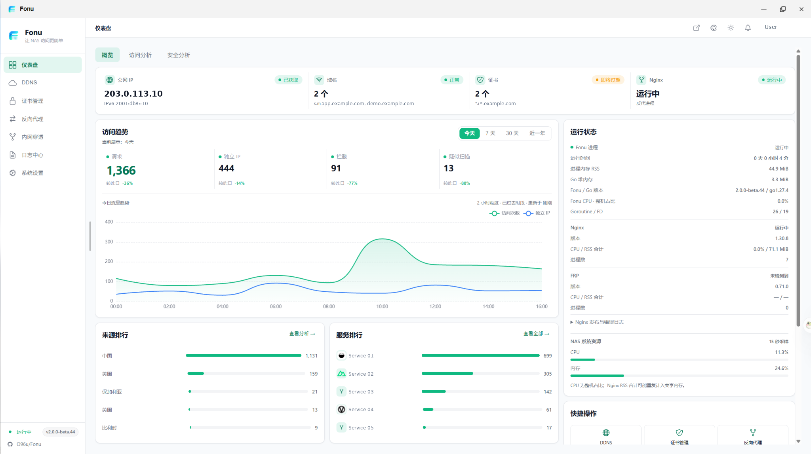
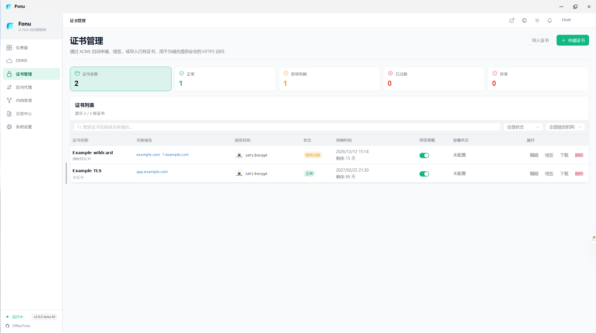
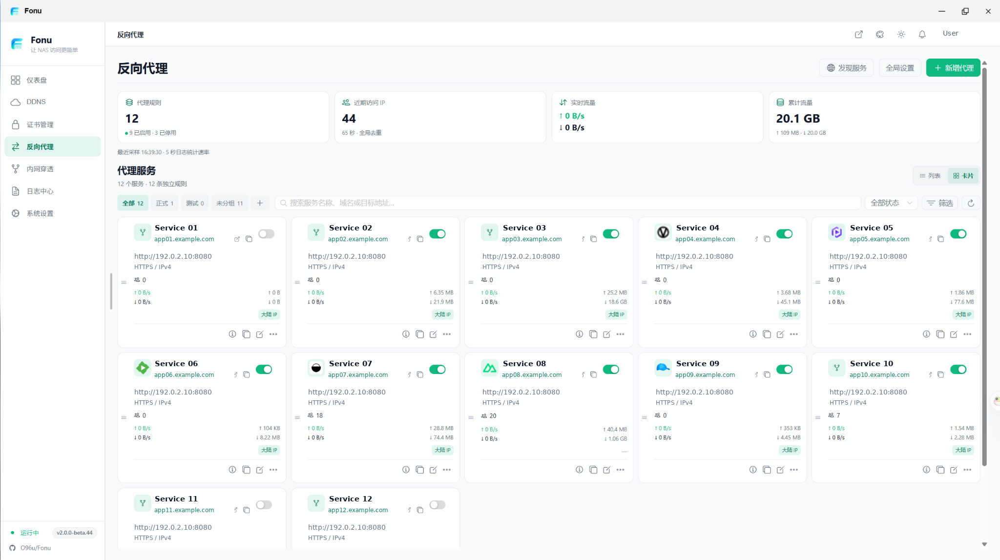
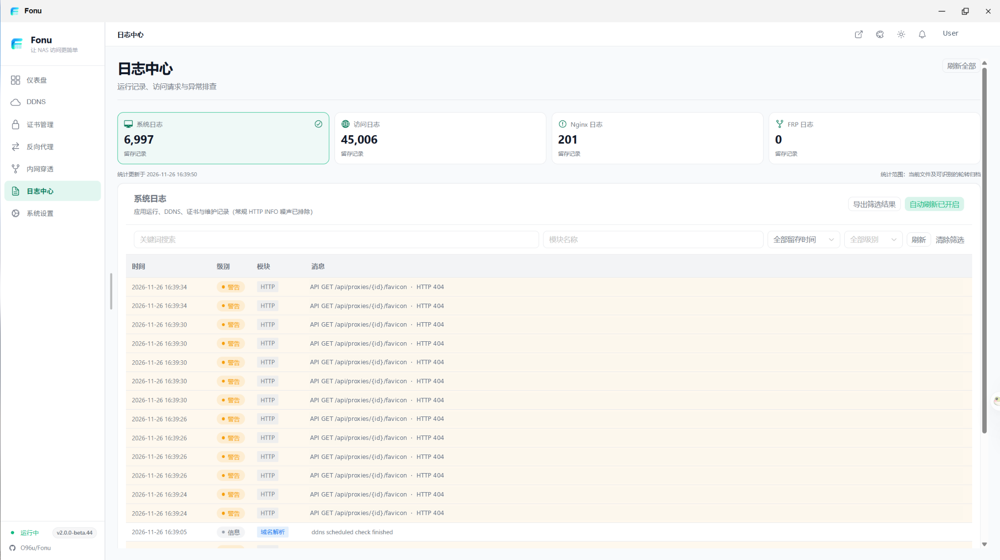
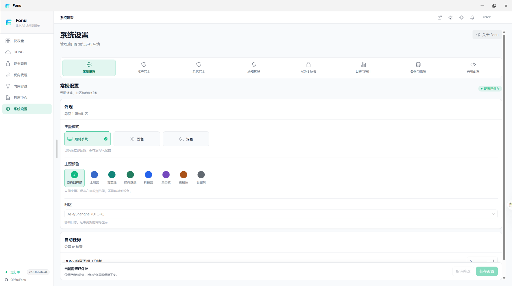
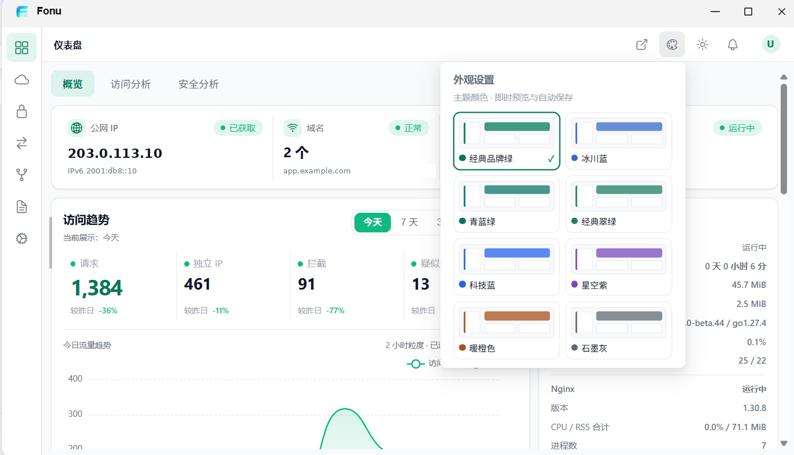

<p align="center"></p>
<h1 align="center">Fonu</h1>
<p align="center"><strong>让 NAS 访问更简单</strong></p>
<p align="center">面向飞牛 fnOS 的 Nginx 反向代理与 FRP 内网穿透管理工具</p>

<p align="center">
  <a href="https://github.com/O96u/Fonu/releases"></a>
  <a href="https://hub.docker.com/r/muxui/fonu"></a>
  
  
  <a href="LICENSE"></a>
</p>

Fonu 是一款面向飞牛 fnOS 的轻量级 Nginx 反向代理管理应用，支持 FRP 内网穿透。通过可视化配置，将 NAS、影音服务、容器及其他内网应用映射至自有域名，实现便捷的 HTTP/HTTPS 访问。内置独立 Nginx，不修改飞牛系统 Nginx。 同时集成 DDNS、HTTPS 证书管理、访问与安全分析、消息通知及备份恢复。

## 功能特性

<table>
  <thead>
    <tr><th width="120">模块</th><th>功能</th></tr>
  </thead>
  <tbody>
    <tr><td width="120">仪&#8288;表&#8288;盘</td><td>IPv4/IPv6、访问与安全分析、服务状态、CPU 和内存监控</td></tr>
    <tr><td width="120">DDNS</td><td>多域名、多记录、自动同步 IPv4/IPv6；支持阿里云、Cloudflare、DNSPod、腾讯云、火山引擎、华为云、DNSHE</td></tr>
    <tr><td width="120">证&#8288;书&#8288;管&#8288;理</td><td>ACME 申请、导入、自动续签、本地与 SSH/SFTP 部署</td></tr>
    <tr><td width="120">反&#8288;向&#8288;代&#8288;理</td><td>HTTP/HTTPS、多域名、多端口、服务分组、发现服务、访问控制、流量统计</td></tr>
    <tr><td width="120">内&#8288;网&#8288;穿&#8288;透</td><td>FRP Web 网关、TCP/UDP 隧道、连接诊断</td></tr>
    <tr><td width="120">日&#8288;志&#8288;中&#8288;心</td><td>系统、访问、Nginx、FRP 日志，实时查看、筛选和导出</td></tr>
    <tr><td width="120">系&#8288;统&#8288;设&#8288;置</td><td>主题、账户安全、日志统计、备份恢复；邮件、Webhook、Telegram、企业微信、飞书通知</td></tr>
  </tbody>
</table>

## 界面展示

<table>
  <tr>
    <td width="50%" align="center"><b>仪表盘</b><br><a href="docs/screenshots/v2/dashboard.png"></a></td>
    <td width="50%" align="center"><b>DDNS</b><br><a href="docs/screenshots/v2/ddns.png"></a></td>
  </tr>
  <tr>
    <td width="50%" align="center"><b>证书管理</b><br><a href="docs/screenshots/v2/certificates.png"></a></td>
    <td width="50%" align="center"><b>反向代理</b><br><a href="docs/screenshots/v2/proxy.png"></a></td>
  </tr>
  <tr>
    <td width="50%" align="center"><b>内网穿透</b><br><a href="docs/screenshots/v2/frp.png"></a></td>
    <td width="50%" align="center"><b>日志中心</b><br><a href="docs/screenshots/v2/logs.png"></a></td>
  </tr>
  <tr>
    <td width="50%" align="center"><b>系统设置</b><br><a href="docs/screenshots/v2/settings.png"></a></td>
    <td width="50%" align="center"><b>主题外观</b><br><a href="docs/screenshots/v2/appearance.png"></a></td>
  </tr>
</table>

## 技术栈

| 层级 | 技术 |
| --- | --- |
| 后端 | Go 1.27、标准库 HTTP、SQLite（modernc.org/sqlite） |
| 前端 | Vue 3.5、TypeScript 5.9、Vite 6、Naive UI 2、ECharts 6、CodeMirror 6 |
| 反向代理 | Nginx（FPK 内置 1.30 系列；Docker 使用发行版软件包） |
| 证书 | go-acme/lego v4（ACME）、SFTP |
| 内网穿透 | FRP 0.72 系列 |
| 构建与部署 | Node.js 22、pnpm 10、GitHub Actions、fnOS FPK、Docker（amd64 / arm64） |

## 安装部署

### 飞牛 fnOS（推荐）

从 [Releases](https://github.com/O96u/Fonu/releases) 下载与 NAS 架构一致的 FPK，在飞牛应用中心手动安装。

| 文件 | 适用场景 |
| --- | --- |
| `fonu_<version>_amd64.fpk` / `fonu_<version>_arm64.fpk` | 普通权限包，推荐日常使用 |
| `fonu_<version>_amd64_root.fpk` / `fonu_<version>_arm64_root.fpk` | 确需 root 权限的场景；风险更高，仅 GitHub 提供 |

两种权限包使用同一应用名，只需安装其中一个。默认数据目录为 `/var/apps/fonu/var/`。证书部署至其他目录时，请先授予应用访问权限。

详细安装、权限与迁移说明见 [FPK 部署文档](packaging/fonu-fpk/README.md)。

### Docker

镜像：[muxui/fonu](https://hub.docker.com/r/muxui/fonu)。默认 `latest` 为稳定镜像；候选版本请以 Releases 或镜像标签实际提供情况为准。

```bash
docker run -d \
  --name fonu \
  --network host \
  --restart unless-stopped \
  --init \
  --security-opt no-new-privileges:true \
  -v ./data:/data \
  -e FONU_NGINX_HTTP_PORT=18080 \
  -e FONU_NGINX_HTTPS_PORT=9443 \
  muxui/fonu:latest
```

也可使用仓库中的 [Docker Compose](docker-compose.yml)；从当前源码构建可执行 `docker compose up -d --build`。

| 入口 | 推荐默认端口 |
| --- | --- |
| 管理后台 | 6893 |
| HTTP 反代 | 18080 |
| HTTPS 反代 | 9443 |

首次访问 `http://<NAS-IP>:6893` 按向导完成初始化。飞牛系统通常已占用 80/443，请避免端口冲突。其他 NAS 或 Linux 环境尚未充分测试。

升级前请备份完整数据目录及原有配置，保留持久化数据；候选版请先在测试环境验证。

## 常用环境变量

| 变量 | 说明 |
| --- | --- |
| `FONU_LISTEN` | 管理后台监听地址，默认 `:6893` |
| `FONU_DATA_DIR` | 数据目录，Docker 默认 `/data` |
| `FONU_NGINX_HTTP_PORT` / `FONU_NGINX_HTTPS_PORT` | 新规则默认 HTTP/HTTPS 端口 |
| `FONU_SESSION_SECRET` | 可选自定义加密密钥；不设置时自动生成，已有实例保留原值 |
| `FONU_TLS_CERT_FILE` / `FONU_TLS_KEY_FILE` | 管理后台 HTTPS 证书链及私钥路径 |

## 本地开发

推荐 Linux / WSL2 环境，准备 Go 1.27（以 go.mod 为准）、Node.js 22、pnpm 10、Nginx；测试 FRP 时另需 frpc。

```bash
git clone -b v2 https://github.com/O96u/Fonu.git
cd Fonu
corepack enable
cd web
pnpm i
pnpm run build
cd ..
mkdir -p cmd/fonu/web/dist
cp -a web/dist/. cmd/fonu/web/dist/
```

终端一：在仓库根目录启动后端，使用独立开发数据目录和非特权端口。

```bash
FONU_DATA_DIR="$PWD/.data-dev" FONU_LISTEN=127.0.0.1:6893 \
  FONU_NGINX_HTTP_PORT=18080 FONU_NGINX_HTTPS_PORT=9443 \
  go run ./cmd/fonu
```

终端二：启动前端热更新。

```bash
cd web
pnpm run dev -- --host 127.0.0.1
```

访问 http://localhost:5173 开发界面，API 由 Vite 转发至 6893。后端代码修改后重启 Go 进程；前端无需反复打包。仅测试整合部署时重新执行前端 build 并复制 dist，再访问 http://127.0.0.1:6893。

```bash
go test ./...
```

日常提交不触发发布。需要测试包或发版时使用 Actions 中的 Release 手动入口，或推送新版本 Tag。

## 开源协议

[GPL-3.0](LICENSE)
